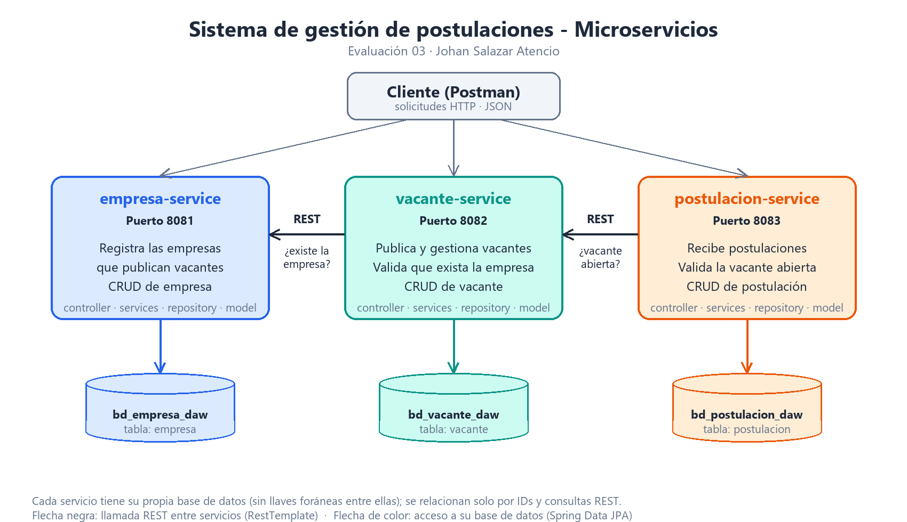

# Práctica Calificada 03 - Sistema de gestión de postulaciones

Evaluación 03 de Desarrollo de Aplicaciones Web (Tecsup). Sistema de microservicios con Spring Boot para publicar vacantes y recibir postulaciones.

**Autor:** Johan Salazar Atencio

## Microservicios

| Servicio | Responsabilidad | Puerto dev | Puerto prod | Base de datos |
|---|---|---|---|---|
| empresa-service | Empresas que publican vacantes | 8081 | 9081 | bd_empresa_daw |
| vacante-service | Vacantes de cada empresa | 8082 | 9082 | bd_vacante_daw |
| postulacion-service | Postulaciones a una vacante | 8083 | 9083 | bd_postulacion_daw |

Cada servicio tiene su propia base de datos y no comparte tablas. Se relacionan solo por IDs y por llamadas REST:

- `vacante-service` consulta a `empresa-service` para comprobar que la empresa existe.
- `postulacion-service` consulta a `vacante-service` para comprobar que la vacante existe, está `ABIERTA` y no venció.



## Requisitos

- JDK 21
- MySQL 8 o MariaDB (XAMPP), usuario `root` sin contraseña en desarrollo
- Maven (cada proyecto trae su `mvnw`)
- Postman (opcional, para la colección)

## Pasos de ejecución (perfil dev)

1. Iniciar MySQL (panel de XAMPP) y crear las bases:
   ```bash
   mysql -uroot < sql/bases-daw.sql
   ```
2. Arrancar los servicios **en este orden** (cada uno en su terminal, dentro de su carpeta):
   ```bash
   cd empresa-service && ./mvnw spring-boot:run
   cd vacante-service && ./mvnw spring-boot:run
   cd postulacion-service && ./mvnw spring-boot:run
   ```
   También se pueden ejecutar desde IntelliJ (clase `...ServiceApplication`) o con `./mvnw -DskipTests package` y `java -jar target/<servicio>-0.0.1-SNAPSHOT.jar`.
3. Importar `postman/postulaciones.postman_collection.json` en Postman y ejecutarla con **Run** (26 solicitudes, casos exitosos y de error).

## Configuración YAML y perfiles

Cada servicio tiene `application.yml` (nombre y perfil activo), `application-dev.yml` y `application-prod.yml`. El perfil se elige con la variable `PROFILE_ACTIVE` (por defecto `dev`).

| Valor | dev | prod |
|---|---|---|
| Puerto | 8081 / 8082 / 8083 | `SERVER_PORT` (9081 / 9082 / 9083) |
| Base de datos | `localhost:3306`, `root` sin contraseña | `DB_URL`, `DB_USER`, `DB_PASSWORD` (variables de entorno) |
| `ddl-auto` | `update` (crea o ajusta las tablas) | `validate` (las tablas deben existir; ver `sql/bases-daw.sql`) |
| Mostrar SQL | sí | no |
| URL de otros servicios | `localhost` | `EMPRESA_URL` / `VACANTE_URL` |

En prod no hay credenciales escritas en el repositorio: se reciben por variables de entorno. El perfil prod apunta a servidores que no existen en este equipo, así que solo se documenta y se comprueba que se activa.

## Endpoints

### empresa-service (`/api/empresas`)

| Método | Ruta | Descripción | Respuesta |
|---|---|---|---|
| GET | `/api/empresas` | Listar | 200 |
| GET | `/api/empresas/{id}` | Buscar por ID | 200 / 404 |
| POST | `/api/empresas` | Registrar | 201 / 400 |
| PUT | `/api/empresas/{id}` | Actualizar | 200 / 400 / 404 |
| DELETE | `/api/empresas/{id}` | Eliminar | 204 / 404 |

Cuerpo: `ruc` (11 dígitos, único), `razonSocial`, `correo`, `telefono` (opcional), `estado` (`ACTIVA` o `INACTIVA`).

### vacante-service (`/api/vacantes`)

| Método | Ruta | Descripción | Respuesta |
|---|---|---|---|
| GET | `/api/vacantes` | Listar (opcional `?idEmpresa=1`) | 200 |
| GET | `/api/vacantes/{id}` | Buscar por ID | 200 / 404 |
| POST | `/api/vacantes` | Publicar | 201 / 400 / 404 / 503 |
| PUT | `/api/vacantes/{id}` | Actualizar | 200 / 400 / 404 / 503 |
| DELETE | `/api/vacantes/{id}` | Eliminar | 204 / 404 |

Cuerpo: `titulo`, `descripcion`, `area`, `fechaCierre` (obligatoria, no puede ser pasada), `idEmpresa`, `estado` (`ABIERTA` o `CERRADA`).

### postulacion-service (`/api/postulaciones`)

| Método | Ruta | Descripción | Respuesta |
|---|---|---|---|
| GET | `/api/postulaciones` | Listar (opcional `?idVacante=1`) | 200 |
| GET | `/api/postulaciones/{id}` | Buscar por ID | 200 / 404 |
| POST | `/api/postulaciones` | Registrar | 201 / 400 / 404 / 503 |
| PUT | `/api/postulaciones/{id}` | Actualizar (por ejemplo, cambiar el estado) | 200 / 400 / 404 |
| DELETE | `/api/postulaciones/{id}` | Eliminar | 204 / 404 |

Cuerpo: `idVacante`, `nombrePostulante`, `correo` (obligatorio y con formato válido), `fecha`, `estado` (opcional: `PENDIENTE`, `EN_REVISION`, `ACEPTADA` o `RECHAZADA`; por defecto `PENDIENTE`).

### Formato de los errores

```json
{
  "fecha": "2026-11-04T00:10:14",
  "estado": 400,
  "error": "Bad Request",
  "mensaje": "Hay datos inválidos en la solicitud",
  "detalles": { "correo": "El correo es obligatorio" }
}
```

| Código | Cuándo |
|---|---|
| 400 | Datos inválidos, JSON o valor de estado incorrecto, RUC repetido, vacante cerrada |
| 404 | El ID buscado no existe (o la empresa o vacante referenciada no existe) |
| 503 | El otro microservicio no responde |
| 500 | Error interno no previsto |

## Estructura

```
empresa-service/ · vacante-service/ · postulacion-service/
  └── com.tecsup.<servicio>
        model       entidades JPA y enum de estados
        dto         datos de entrada con validaciones
        repository  acceso a datos (Spring Data JPA)
        services    interfaz + implementación con la lógica
        controller  endpoints REST
        exception   errores y GlobalExceptionHandler
        client      llamadas REST a otro servicio (vacante y postulacion)
        config      RestTemplate (vacante y postulacion)
sql/       script de las bases de datos
postman/   colección de pruebas
docs/      diagrama de microservicios
```

## Tecnologías

Java 21, Spring Boot 4.1.2, Maven, Spring Web, Spring Data JPA (Hibernate), MySQL, Validation y configuración con YAML.
